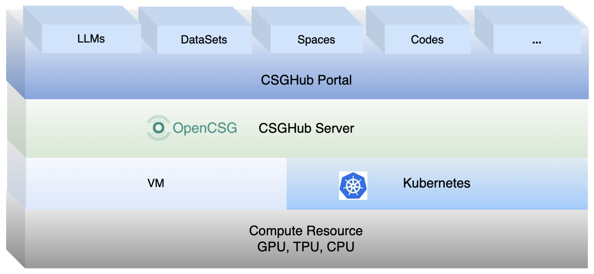

**[English](README.md) ∙ [简体中文](README_zh.md) ∙ [日本語](README_jp.md) ∙ [한국어](README_kr.md) ∙ [Español](README_es.md)**

## CSGHub

CSGHub là một nền tảng mã nguồn mở dùng để quản lý tài sản của Mô hình Ngôn ngữ Lớn (LLM), giúp xử lý hiệu quả toàn bộ LLM cùng các tài sản đi kèm như tập dữ liệu (dataset), Space, mã nguồn, v.v. Người dùng có thể tải lên, tải xuống, lưu trữ, xác minh và phân phối các tài sản LLM như DeepSeek, Llama, v.v. thông qua giao diện web, dòng lệnh `git`, Chatbot bằng ngôn ngữ tự nhiên hoặc [CSGHub SDK](https://github.com/OpenCSGs/csghub-sdk).

Ngoài ra, CSGHub được xây dựng từ các module con dạng microservice và cung cấp OpenAPI chuẩn hóa, giúp tích hợp liền mạch với các hệ thống sẵn có. Mục tiêu của CSGHub là mang đến một nền tảng quản lý dễ sử dụng, được thiết kế riêng cho LLM, có thể triển khai tại chỗ (On-Premise) để vận hành an toàn, hoàn toàn ngoại tuyến. Nói ngắn gọn, CSGHub là một phiên bản Huggingface riêng tư, triển khai tại chỗ.

### Tính năng chính

- Quản lý LLM hợp nhất
- Khung phát triển có khả năng mở rộng
- Năng lực mô hình nâng cao và tối ưu hóa
- Trợ lý quản lý Space và tài sản (Copilot)
- Đồng bộ dữ liệu đa nguồn và gợi ý
- Bảo mật và kiểm soát truy cập cấp doanh nghiệp
- Giải pháp triển khai tại chỗ (On-Premise)
- Hệ thống xử lý dữ liệu đầu-cuối (E2E) và gán nhãn thông minh
- Kiến trúc linh hoạt, tính sẵn sàng cao

Để biết thêm thông tin, vui lòng xem [giới thiệu chi tiết](./docs/detailed_intro_vi.md) về CSGHub.

### Video demo

Để giúp người dùng nhanh chóng làm quen với CSGHub, chúng tôi đã thực hiện một video demo giới thiệu các tính năng chính và cách hoạt động của nền tảng. Bạn có thể xem ngay bên dưới hoặc trên [YouTube](https://www.youtube.com/watch?v=6LwGQ07qBxU)/[Bilibili](https://www.bilibili.com/video/BV1ynmxY3EXz/).
<video width="658" height="432" src="https://github.com/user-attachments/assets/04f9fa17-9294-44c1-8c4a-4d7b9a5c66fa"></video>

### Bắt đầu nhanh

- Nếu bạn muốn khám phá nhanh, hãy dùng thử phiên bản SaaS miễn phí của CSGHub trên [trang web OpenCSG](https://opencsg.com). Tham khảo [hướng dẫn bắt đầu nhanh](./docs/csghub_saas_vi.md) này để làm việc với LLM/tập dữ liệu và triển khai ứng dụng LLM bằng giao diện CSGHub SaaS.

- **Dành cho người dùng muốn thực hành sâu hơn:** Vui lòng tham khảo [tài liệu chính thức của CSGHub](https://opencsg.com/docs/csghub/101/introduction). Tài liệu hiện cung cấp các cách cài đặt bằng [Docker Compose](https://opencsg.com/docs/en/csghub/101/install/docker/overview) và [Helm Chart](https://opencsg.com/docs/en/csghub/101/install/kubernetes/overview).

    _Để biết thêm thông tin và các hướng dẫn nâng cao, vui lòng tham khảo [Trung tâm tài liệu OpenCSG](https://opencsg.com/docs/intro)._

### Dùng thử nhanh

### Lộ trình phát triển

Xem [lộ trình](./docs/roadmap_vi.md) mô tả định hướng phát triển của CSGHub trong tương lai.

### Ghi chú phát hành

Tham khảo [ghi chú phát hành](./docs/release_notes_vi.md) để biết thông tin về các cải tiến tính năng.

### Họp cộng đồng & Đóng góp

Chúng tôi trân trọng mời bạn khám phá [Cộng đồng OpenCSG](https://github.com/OpenCSGs/community), nơi bạn sẽ tìm thấy hướng dẫn đầy đủ để trở thành một phần quan trọng của dự án.

- Quy trình tham gia [các buổi họp cộng đồng](https://github.com/OpenCSGs/community?tab=readme-ov-file#community-meeting), nơi bạn có thể giao lưu với các thành viên khác và chia sẻ ý tưởng.
- Tham khảo [hướng dẫn đóng góp](https://github.com/OpenCSGs/community/blob/main/guidelines/CONTRIBUTING_en.md) để biết cách đóng góp cho dự án.
- [Liên hệ với chúng tôi](https://github.com/OpenCSGs/community?tab=readme-ov-file#questions-and-issues) nếu bạn có bất kỳ câu hỏi hay vấn đề nào, để bạn luôn được hỗ trợ trong suốt hành trình cùng OpenCSG.
- Tham khảo [hướng dẫn phát triển](./docs/setup_vi.md) để biết cách thiết lập môi trường phát triển.
