# Hướng dẫn bắt đầu nhanh với CSGHub SaaS

## Đăng ký và thiết lập

### Đăng ký và đăng nhập

**1. Truy cập dịch vụ CSGHub SaaS:**

- Mở [Trang chủ OpenCSG](https://opencsg.com/) để trải nghiệm dịch vụ CSGHub SaaS.

**2. Đăng ký tài khoản:**

- Nhấn nút `Login/Register` (Đăng nhập/Đăng ký) ở góc trên bên phải trang.
- Điền thông tin tài khoản (tên người dùng, mật khẩu, số điện thoại và email) để hoàn tất đăng ký.

**3. Đăng nhập:**

- Dùng tên người dùng và mật khẩu để đăng nhập.

### Cấu hình SSH Key (Không bắt buộc)

**1. Thêm SSH Key:**

- Vào trang "Account Settings > SSH Keys" (Cài đặt tài khoản > SSH Keys) và nhấn `Add SSH Key`.
- Dán khóa công khai SSH của bạn vào và lưu lại.

**2. Sử dụng lệnh Git:**

- Sau khi cấu hình xong, bạn có thể push và pull nội dung repository bằng Git.

## Quản lý mô hình: Tạo, tải lên và tải xuống

### Tạo repository mô hình

Sau khi đăng nhập vào nền tảng, nhấn vào ảnh đại diện, bạn sẽ thấy nút `New Model`. Nhấn vào đó để vào trang tạo repository mô hình. Điền các thông tin cơ bản sau để tạo:

- Chủ sở hữu repository mô hình mặc định là tên người dùng của bạn, nhưng bạn có thể chọn tên tổ chức trong danh sách thả xuống.
- Tên và mô tả mô hình.
- Chọn loại giấy phép (license).
- Chọn có công khai mô hình hay không.

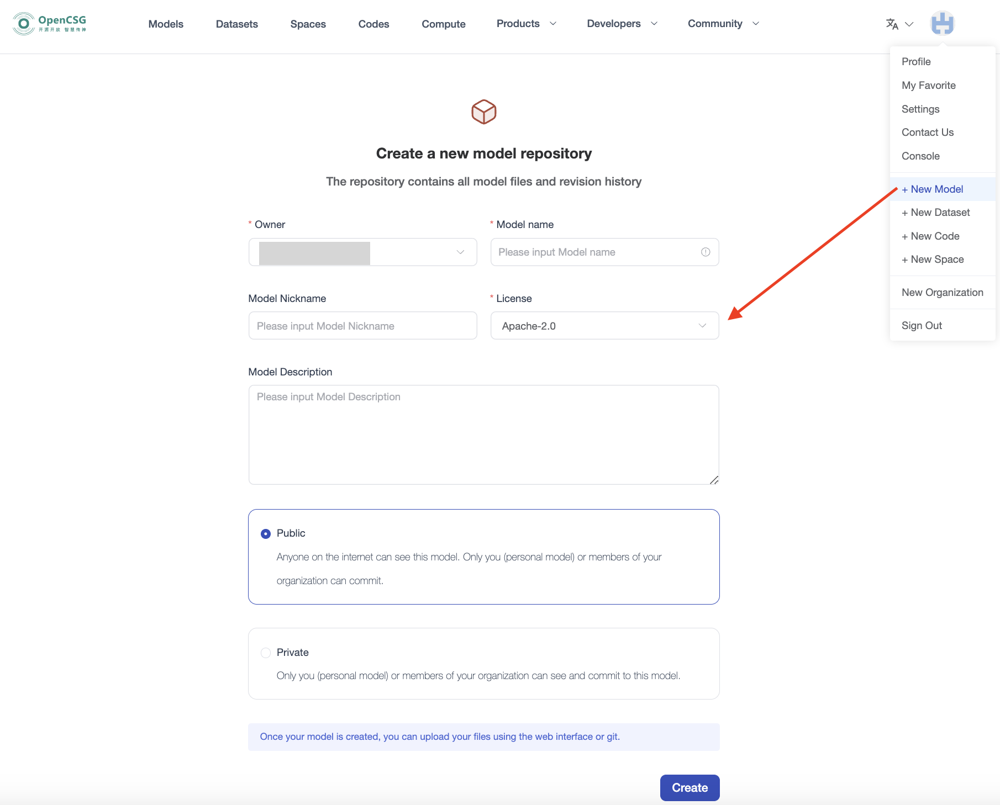

### Tải lên tệp mô hình

- **Tải lên qua giao diện web:**
  Nhấn `Add File`, rồi chọn "Create new file" (Tạo tệp mới) hoặc "Upload file" (Tải tệp lên).
  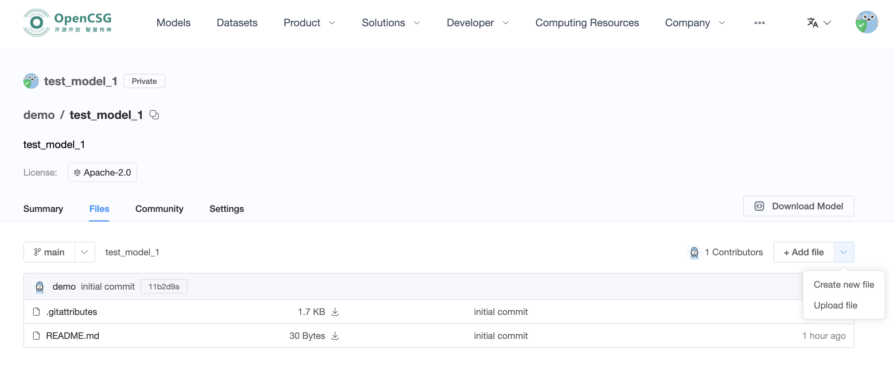

- **Tải lên qua Git:**
  Đảm bảo Git đã được cài đặt trên máy và thông tin tài khoản Git đã được cấu hình. Sau đó, thực hiện các bước sau:

  1. Trước tiên, tải repository mô hình về bằng Git, rồi sao chép các tệp mô hình bạn muốn tải lên vào repository tương ứng.
  2. Giả sử tệp mô hình của bạn nằm trong thư mục cục bộ `/work/my_model_dir`, bạn có thể tải chúng lên repository mô hình đã tạo trên nền tảng bằng các lệnh sau:
    ```
    cd test_model
    cp -rf /work/my_model_dir/* .
    git add .
    git commit -m "commit message"
    git push
    ```

### Tải xuống mô hình

- **Tải xuống qua giao diện web:**
  Nhấn nút tải xuống trên trang danh sách tệp để tải trực tiếp tệp đó.
  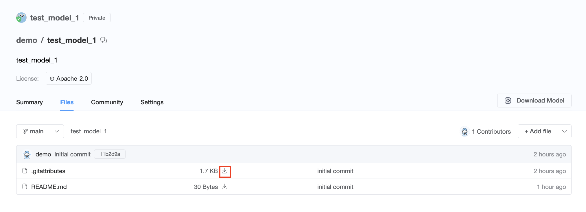

- **Tải xuống qua Git:**

  1. Tải xuống qua **HTTP**:
    ```
    git lfs install
    git clone https://opencsg.com/models/demo/test_model.git
    ```

  2. Tải xuống qua **SSH**:
    ```
    git lfs install
    git clone git@hub.opencsg.com/models/demo/test_model.git
    ```

- **Tải xuống qua SDK:**
  [CSGHub SDK](https://github.com/OpenCSGs/csghub-sdk) cung cấp một thư viện Python cho phép bạn tải dữ liệu xuống thông qua SDK.
  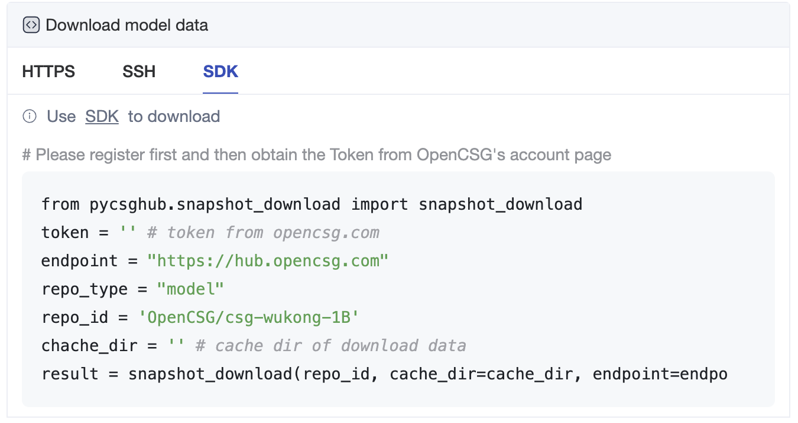

## Suy luận và tinh chỉnh

### Suy luận (Inference)

#### Tạo một phiên bản chuyên dụng

Chọn một mô hình và nhấn `Deploy` trên trang mô hình. Trong menu thả xuống, chọn "Dedicated endpoint" (Endpoint chuyên dụng) và chuyển đến trang tạo.
> Lưu ý: Chỉ một số mô hình hỗ trợ tạo endpoint chuyên dụng. Nếu mô hình bạn muốn dùng không có tùy chọn "Dedicated endpoint", vui lòng liên hệ với chúng tôi qua <contact@opencsg.com>.

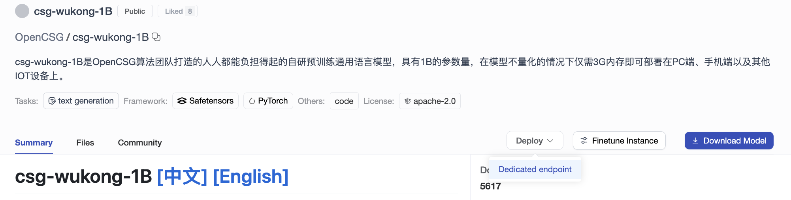

Trên trang tạo endpoint chuyên dụng, điền các thông tin cơ bản sau, rồi nhấn nút `Create`.
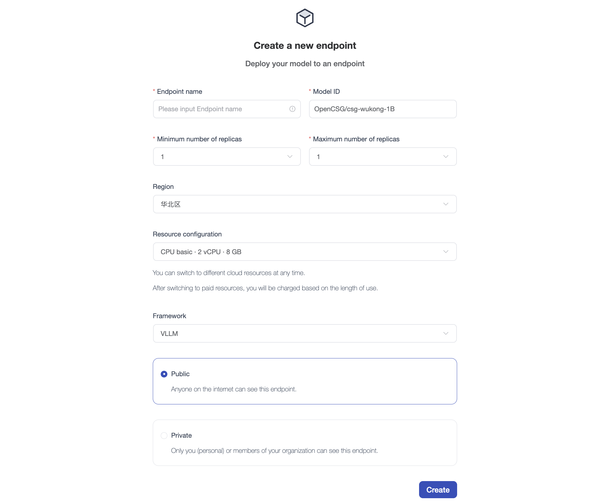

- Tên endpoint: Tùy chọn, phải là duy nhất.
- Model ID: ID của mô hình trong cộng đồng CSGHub.
- Khoảng số bản sao (replicas): 1~5.
- Chọn khu vực và cấu hình tài nguyên.
- Chọn framework suy luận.
- Chọn có công khai endpoint hay không.

#### Sử dụng endpoint chuyên dụng

##### Tổng quan (Summary)

Trên trang "Summary", bạn có thể xem URL và trạng thái hoạt động của endpoint chuyên dụng. Bạn có thể dùng URL này để gọi endpoint chuyên dụng.

##### Playground

Module Playground cho phép người dùng tương tác với mô hình qua giao diện đồ họa mà không cần viết mã, để kiểm tra kết quả suy luận.
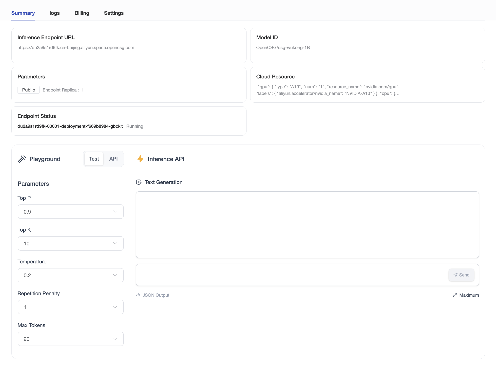

### Tinh chỉnh (Fine-tuning)

#### Tạo phiên bản tinh chỉnh

Nhấn `Finetune Instance` trên trang mô hình để chuyển đến trang tạo.
> Lưu ý: Chỉ một số mô hình hỗ trợ tạo phiên bản tinh chỉnh. Nếu mô hình bạn muốn dùng không có tùy chọn "Finetune Instance", vui lòng liên hệ với chúng tôi qua <contact@opencsg.com>.

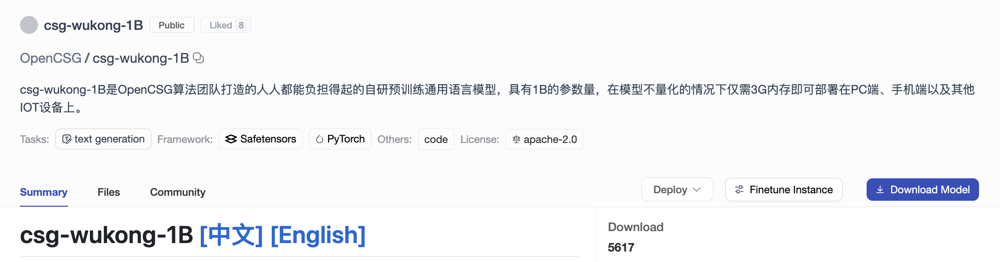

Trên trang tạo phiên bản tinh chỉnh, điền các thông tin cơ bản sau, rồi nhấn nút "Create Instance".
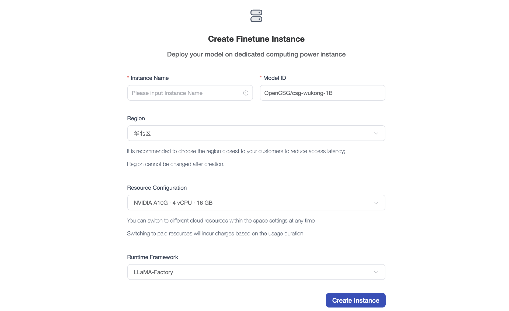

- Tên phiên bản: Tùy chọn, phải là duy nhất.
- Model ID: ID của mô hình trong cộng đồng CSGHub.
- Chọn khu vực và cấu hình tài nguyên.
- Chọn framework chạy (runtime framework).

#### Sử dụng phiên bản tinh chỉnh

##### Tổng quan (Overview)

Cấu hình tham số trên trang Overview, chọn tập dữ liệu và bắt đầu quá trình tinh chỉnh mô hình.

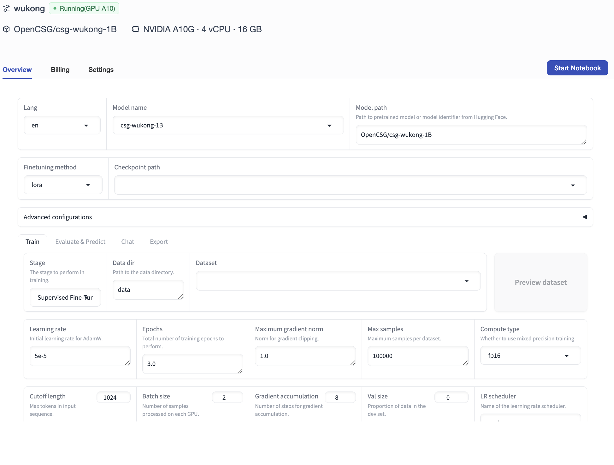

Bạn cũng có thể nhấn nút `Start Notebook` để tinh chỉnh mô hình thông qua giao diện Notebook.

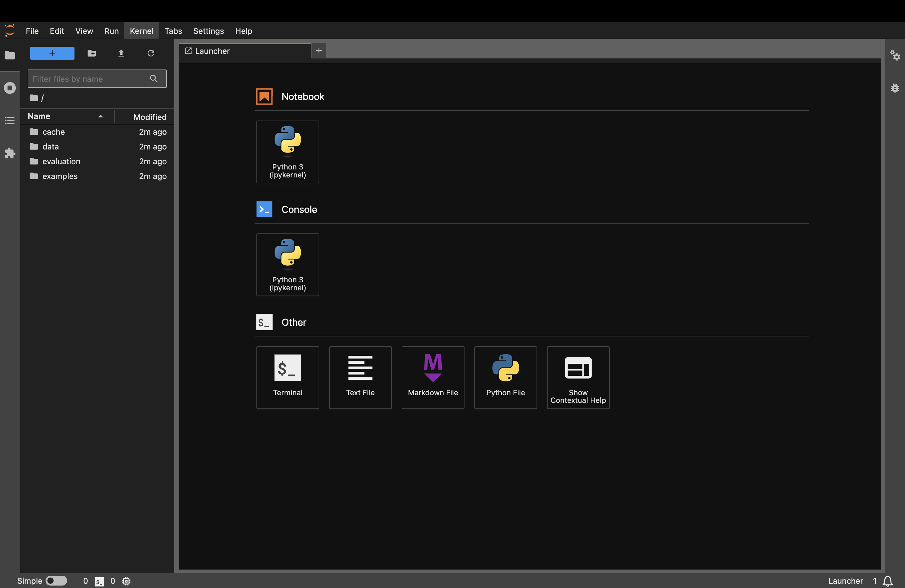

##### Ví dụ các tham số quan trọng khi tinh chỉnh bằng LLaMA Factory

Sau khi cấu hình tham số, nhấn nút `Start`, LLaMA Factory sẽ bắt đầu tinh chỉnh mô hình theo các thiết lập của bạn.

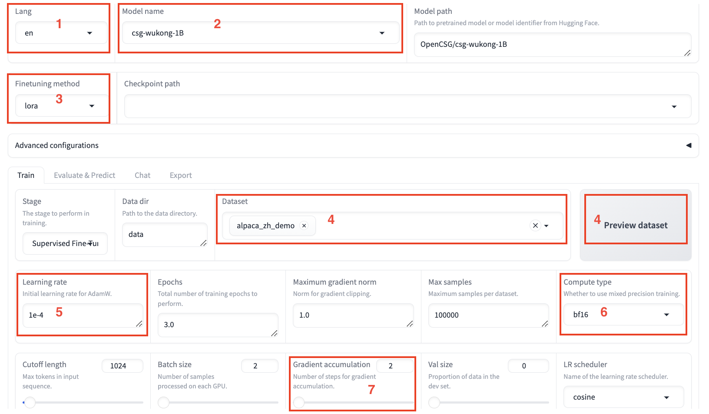
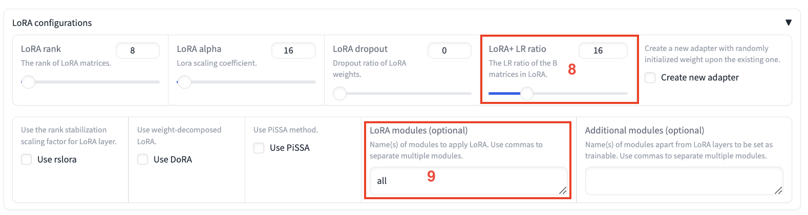
| Vùng | Tham số              | Giá trị đề xuất | Mô tả                                              |
| :--: | :------------------- | :-------------- | :------------------------------------------------- |
| ①    | Language (Ngôn ngữ)  | en              | Không có                                           |
| ②    | Model Name (Tên mô hình) | csg-wukong-1B | Không có                                         |
| ③    | Finetuning Method (Phương pháp tinh chỉnh) | lora | Dùng phương pháp tinh chỉnh nhẹ LoRA giúp giảm đáng kể lượng bộ nhớ sử dụng. |
| ④    | Dataset (Tập dữ liệu) | train          | Sau khi chọn tập dữ liệu, nhấn **Preview Dataset** để xem chi tiết tập dữ liệu. |
| ⑤    | Learning Rate (Tốc độ học) | 1e-4     | Giúp mô hình hội tụ tốt hơn.                       |
| ⑥    | Compute Type (Kiểu tính toán) | bf16  | Nếu dùng GPU V100, nên chọn fp16; nếu dùng A10, nên chọn bf16. |
| ⑦    | Gradient Accumulation (Tích lũy gradient) | 2 | Giúp mô hình hội tụ tốt hơn.                |
| ⑧    | LoRA + LR Ratio      | 16              | LoRA+ đã được chứng minh cho kết quả tốt hơn LoRA. |
| ⑨    | LoRA Modules         | all             | `all` nghĩa là các lớp LoRA sẽ được áp dụng cho tất cả các lớp tuyến tính trong mô hình để cải thiện khả năng hội tụ. |

##### Kết quả tinh chỉnh

- **Trước khi tinh chỉnh:**

  Trong tab `Chat`, nhấn **Load Model** để trò chuyện với mô hình chưa tinh chỉnh trên giao diện web. Nhập nội dung bạn muốn hỏi mô hình vào ô chat ở cuối trang và nhấn **Submit**. Sau khi gửi tin nhắn, mô hình sẽ tạo câu trả lời, nhưng trước khi tinh chỉnh, mô hình có thể chưa trả lời đúng bằng tiếng Trung.
  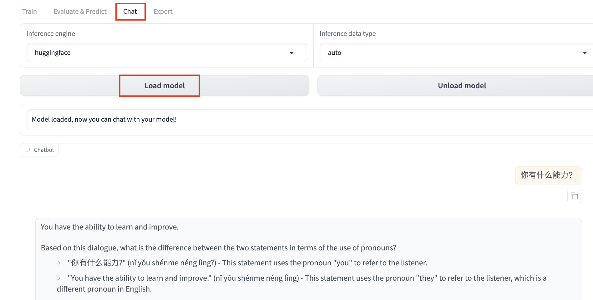

- **Sau khi tinh chỉnh:**

  Nhấn **Unload Model**, sau đó nhấn **Load Model** để trò chuyện với mô hình đã tinh chỉnh. Gửi lại cùng nội dung, bạn sẽ thấy mô hình đã học từ tập dữ liệu và giờ có thể trả lời phù hợp bằng tiếng Trung.
  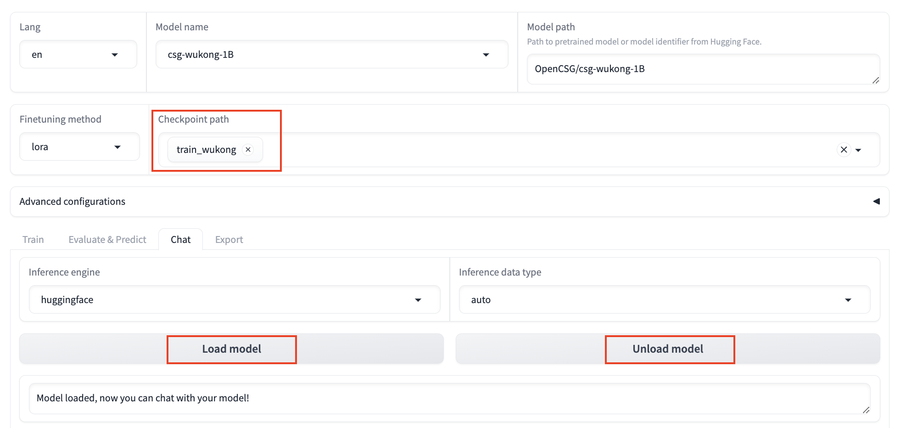
  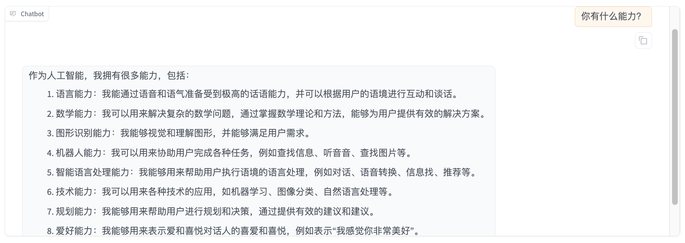

Trên đây là phần khám phá cơ bản về dịch vụ CSGHub SaaS. Để biết thêm thông tin, vui lòng tham khảo [Trung tâm tài liệu OpenCSG](https://opencsg.com/docs/en/intro).
