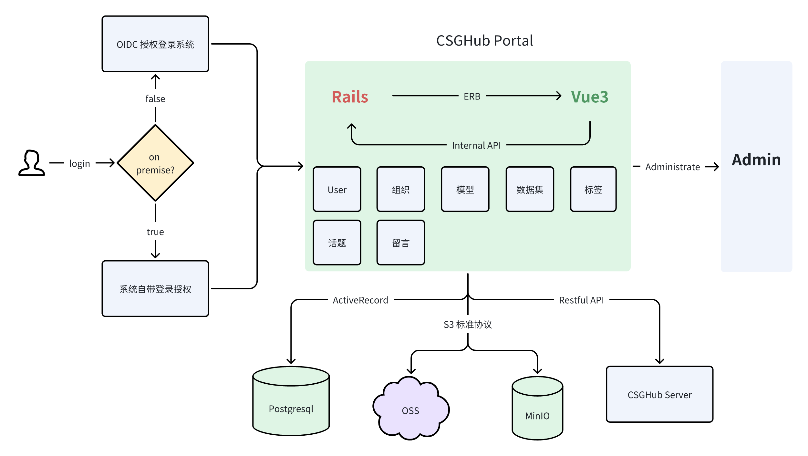
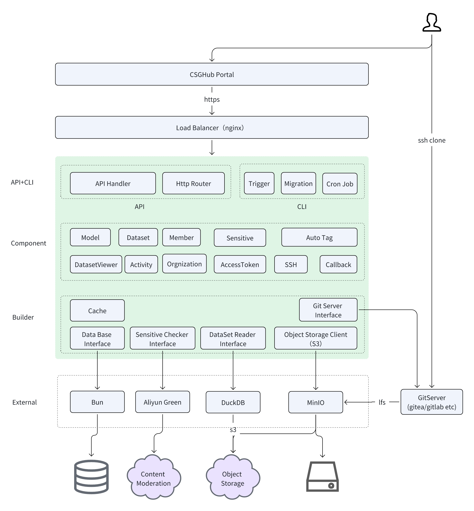

# CSGHub: Tổng quan chi tiết về tính năng và kiến trúc

Khi Mô hình Ngôn ngữ Lớn (LLM) ngày càng giữ vai trò trung tâm trong chuyển đổi số, các tổ chức phải đối mặt với nhiều thách thức hơn trong việc quản lý những tài sản LLM phức tạp này. Họ thường gặp khó khăn với công cụ rời rạc, lựa chọn quản lý hạn chế và các mối lo ngại về bảo mật. CSGHub là nền tảng mã nguồn mở được thiết kế để giải quyết những thách thức đó, giúp việc quản lý tài sản LLM trở nên đơn giản và an toàn.

## Các tính năng chính của CSGHub

- **Quản lý LLM hợp nhất:**
  - Quản lý toàn bộ vòng đời của mô hình, tập dữ liệu và mã nguồn
  - Hỗ trợ thao tác với tệp lớn và cộng tác trên nền web
  - Tích hợp quản lý phiên bản và theo dõi tài sản

- **Khung phát triển có khả năng mở rộng:**
  - Hỗ trợ đầy đủ giao thức HTTPS và SSH
  - Tích hợp liền mạch với các SDK phổ biến (Gradio, Streamlit)
  - Tự động tối ưu môi trường cho việc triển khai mô hình
  - Suy luận và tinh chỉnh (fine-tuning) chỉ với một thao tác

- **Năng lực mô hình nâng cao và tối ưu hóa:**
  - Tự động theo dõi mọi phiên bản mô hình
  - Tích hợp sẵn công cụ chuyển đổi định dạng mô hình và xử lý dữ liệu
  - Hỗ trợ chuyển đổi nhiều định dạng dữ liệu (CSV, JSON, Parquet)
  - Xem trước dữ liệu trên nền web

- **Trợ lý quản lý Space và tài sản (Copilot):**
  - Nhanh chóng xây dựng và giới thiệu ứng dụng AI
  - Quản lý tài sản linh hoạt thông qua trợ lý Copilot
  - Tùy chọn triển khai tại chỗ sẵn sàng cho doanh nghiệp

- **Đồng bộ dữ liệu đa nguồn và gợi ý:**
  - Tích hợp với cộng đồng OpenCSG
  - Hỗ trợ đồng bộ mô hình và tập dữ liệu trong cộng đồng
  - Gợi ý giải pháp theo từng tình huống sử dụng

- **Bảo mật và kiểm soát truy cập cấp doanh nghiệp:**
  - Hỗ trợ tích hợp với hệ thống người dùng của doanh nghiệp
  - Thiết lập phạm vi hiển thị của tài sản
  - Theo dõi và xác minh giấy phép (license)

- **Giải pháp triển khai tại chỗ (On-Premise):**
  - Triển khai tại chỗ chỉ với một thao tác
  - Vận hành không phụ thuộc đám mây
  - Toàn quyền kiểm soát dữ liệu

- **Hệ thống xử lý dữ liệu đầu-cuối (E2E) và gán nhãn thông minh:**
  - Pipeline xử lý dữ liệu có thể tùy biến
  - Tăng tốc xử lý bằng tính toán song song
  - Cộng tác trong các tác vụ gán nhãn dữ liệu

- **Kiến trúc linh hoạt, tính sẵn sàng cao:**
  - Hỗ trợ kiến trúc sẵn sàng cao (high availability)
  - Hỗ trợ cân bằng tải và điều phối tài nguyên để đảm bảo ổn định
  - Hỗ trợ khôi phục sau thảm họa để đảm bảo hoạt động kinh doanh liên tục

## Thiết kế kỹ thuật của CSGHub

Chúng tôi xây dựng CSGHub trên những công nghệ đã được kiểm chứng để nền tảng vừa mạnh mẽ vừa tin cậy:

- CSGHub tích hợp Git server với giao thức Git LFS và Dịch vụ Lưu trữ Đối tượng (Object Storage Service) để tạo nên một hệ thống lưu trữ tin cậy. Sự tích hợp này mang lại khả năng truy cập linh hoạt cho các công cụ phát triển, đồng thời vẫn đảm bảo năng lực quản lý dữ liệu toàn diện.
- Được xây dựng trên kiến trúc hướng dịch vụ, CSGHub gồm một máy chủ backend (CSGHub Server) và giao diện web (CSGHub Portal) để quản lý liền mạch. Người dùng có thể nhanh chóng triển khai dịch vụ bằng Docker Compose hoặc Kubernetes Helm Chart, còn nhà phát triển có thể mở rộng chức năng thông qua CSGHub Server cho các tích hợp tùy biến và tính năng nâng cao.
- Nhờ tận dụng Apache Arrow và DuckDB, CSGHub giúp việc quản lý tập dữ liệu trở nên đơn giản cho cả nhà nghiên cứu lẫn người dùng phổ thông, với chức năng xem trước tệp Parquet tiện lợi cho tập dữ liệu cục bộ.
- Nền tảng có giao diện web gọn gàng cùng hệ thống phân quyền sẵn sàng cho doanh nghiệp. Người dùng có thể dễ dàng quản lý phiên bản, duyệt tệp trực tuyến, cấu hình quyền truy cập và tham gia thảo luận về mô hình và tập dữ liệu.

Đội ngũ R&D của chúng tôi tập trung vào AI + DevOps, với mục tiêu giải quyết các thách thức trong phát triển LLM thông qua dự án CSGHub. Chúng tôi hoan nghênh mọi đóng góp để làm phong phú tài liệu và nâng cao năng lực của nền tảng.

## Kiến trúc CSGHub

Repository này chứa mã nguồn của CSGHub Portal, còn CSGHub Server được phát triển thành một dự án backend hiệu năng cao riêng biệt bằng Golang.

Để tìm hiểu chi tiết về CSGHub Server hoặc cách tích hợp nó với hệ thống frontend của riêng bạn, hãy xem [dự án mã nguồn mở CSGHub Server](https://github.com/OpenCSGs/csghub-server).

### Kiến trúc CSGHub Portal

### Kiến trúc CSGHub Server

