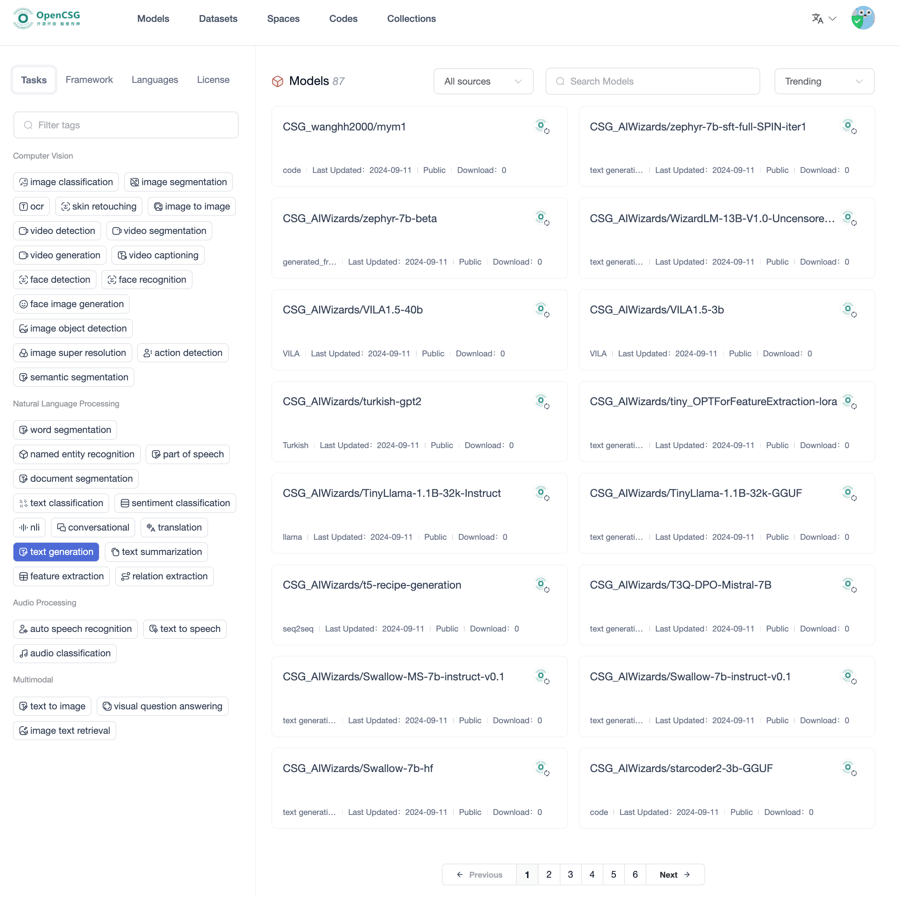
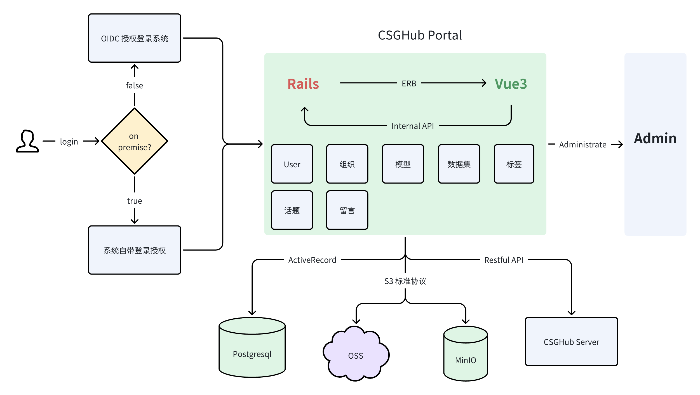
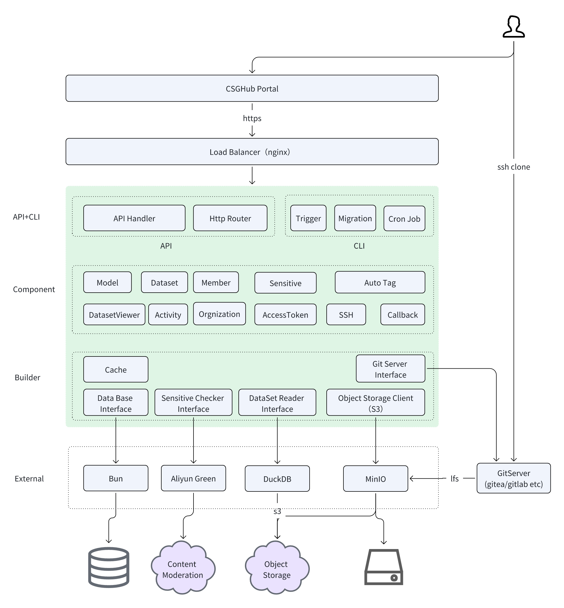
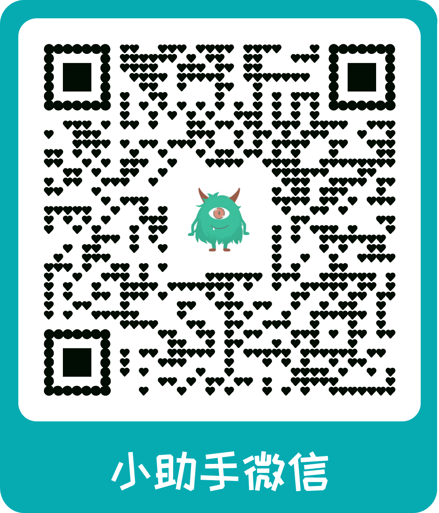
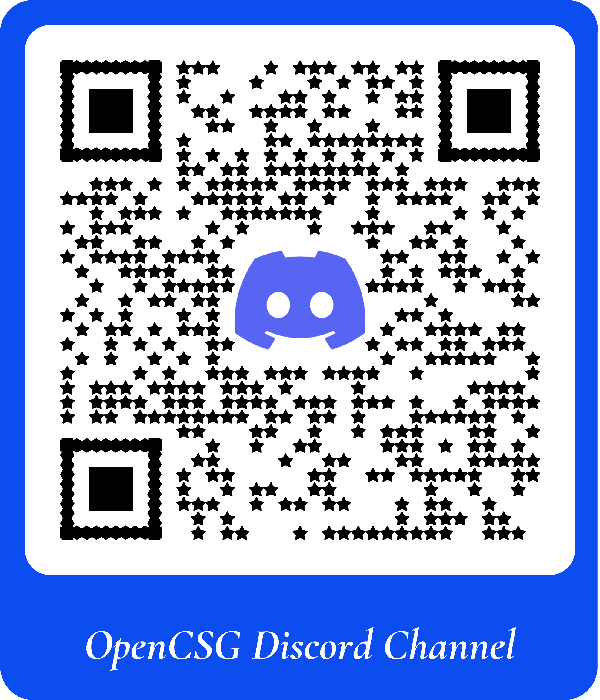
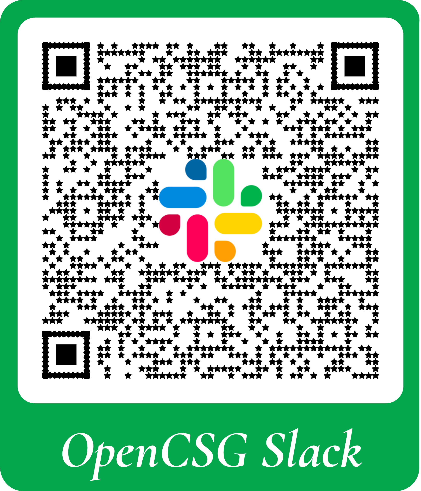

**[简体中文](/docs/readme_cn.md) ∙ [English](/docs/readme_en.md) ∙ [日本語](/docs/readme_ja.md)  ∙ [한국어](/docs/readme_kr.md) ∙ [Tiếng Việt](/docs/readme_vi.md)**
## CSGHub README

CSGHub là một nền tảng quản lý tài sản mô hình lớn mã nguồn mở và đáng tin cậy, giúp người dùng quản trị các tài sản xuất hiện trong vòng đời của LLM và ứng dụng LLM (tập dữ liệu, tệp mô hình, mã nguồn, v.v.).

Với CSGHub, người dùng có thể thao tác với tài sản LLM, bao gồm tải lên, tải xuống, lưu trữ, xác minh và phân phối, thông qua giao diện Web, dòng lệnh Git hoặc Chatbot bằng ngôn ngữ tự nhiên. Đồng thời, nền tảng cung cấp các module con dạng microservice và OpenAPI chuẩn hóa, có thể dễ dàng tích hợp vào hệ thống riêng của người dùng.

CSGHub hướng tới việc mang đến cho người dùng một nền tảng quản lý tài sản được thiết kế nguyên bản cho mô hình lớn, có thể triển khai tại chỗ (On-Premise) để vận hành hoàn toàn ngoại tuyến. CSGHub cung cấp các chức năng tương tự một Huggingface riêng tư (Huggingface triển khai tại chỗ), quản lý tài sản LLM theo cách tương tự như OpenStack Glance quản lý ảnh máy ảo, Harbor quản lý container image và Sonatype Nexus quản lý artifact.

Bạn có thể dùng thử phiên bản SaaS miễn phí của CSGHub qua trang web chính thức của Cộng đồng OpenCSG: https://opencsg.com Bạn cũng có thể chuyển đến phần [Bắt đầu nhanh](#quick-start) để nhanh chóng khởi chạy một phiên bản cục bộ và khám phá mọi tính năng của CSGHub.

### CẬP NHẬT
- [2024.08.15] v0.8.0 Bản phát hành lớn: giới thiệu dịch vụ độc lập `user_server` và chuyển việc quản lý người dùng, tổ chức, token từ `CSGHub` sang máy chủ backend `CSGHub-server`; giới thiệu dịch vụ độc lập `starhub_server_runner service` để triển khai thống nhất Application Space, suy luận mô hình và tinh chỉnh (fine-tune). Tăng cường quản lý tài nguyên, đã hỗ trợ nhiều cụm k8s ở các khu vực khác nhau.
- [2024.07.15] v0.7.0 Bản phát hành lớn: hỗ trợ `Đồng bộ đa nguồn` (Multiple Resource Sync) cho mô hình và tập dữ liệu, tinh chỉnh một chạm, đo lường mức sử dụng tài nguyên.
- [2024.06.21] v0.6.1 Sửa lỗi và cải thiện trải nghiệm người dùng.
- [2024.06.18] v0.6.0 Bản phát hành lớn: hỗ trợ endpoint suy luận mô hình `chuyên dụng` (dedicated), hỗ trợ Space `streamlit`, cho phép `thích` (like) repo, cho phép đặt `nhãn ngành` (industry tag) cho repo, cải thiện chi tiết lịch sử git và so sánh khác biệt của commit.
- [2024.05.14] v0.5.0 Cải thiện trải nghiệm Space, tự động xây dựng `quan hệ` giữa các repo (mô hình, tập dữ liệu, mã nguồn và Space), hỗ trợ tải lên nhiều tệp cùng lúc.
- [2024.04.18] v0.4.0 Cho phép chạy `Application Space` (ứng dụng gradio), thêm widget để thử suy luận mô hình, hỗ trợ loại repo mới `Code`, hỗ trợ quản lý thành viên tổ chức, hỗ trợ đăng nhập bằng WeChat.
- [2024.03.15] v0.3.0 Kế hoạch: chỉnh sửa tệp trực tuyến, chỉnh sửa tổ chức, xem trước tập dữ liệu.
- [2024.02.15] v0.2.0 Cải thiện chức năng lưu trữ mô hình và tập dữ liệu, thêm tính năng mời thành viên mới vào tổ chức.
- [2024.01.15] v0.1.0 Phát hành phiên bản Alpha của CSGHub, hỗ trợ chức năng quản lý mô hình và tập dữ liệu, chi tiết như bên dưới.

### CHỨC NĂNG CỐT LÕI
Trong kỷ nguyên LLM, dữ liệu và mô hình ngày càng trở thành những tài sản số quan trọng nhất đối với doanh nghiệp và người dùng cá nhân. Tuy nhiên, hiện vẫn tồn tại các vấn đề như công cụ quản lý phân mảnh, phương thức quản lý hạn chế và khó triển khai cục bộ. Những vấn đề này không chỉ tiềm ẩn nguy cơ đối với vận hành an toàn mà còn có thể cản trở việc cập nhật và cải tiến mô hình ở quy mô doanh nghiệp. Nếu bạn tin rằng mô hình lớn sẽ là động lực chính của cuộc cách mạng sắp tới, có lẽ bạn cũng đang cân nhắc làm sao để quản lý các tài sản cốt lõi — mô hình, dữ liệu và mã nguồn ứng dụng mô hình lớn — một cách hiệu quả và an toàn hơn. CSGHub là dự án mã nguồn mở được thiết kế để giải quyết những vấn đề này.

Các chức năng cốt lõi của CSGHub (cập nhật thường xuyên):
- **Quản lý tài sản LLM hợp nhất**: Một Hub tập trung để quản lý thống nhất tệp mô hình, tập dữ liệu và mã nguồn ứng dụng mô hình lớn.
- **Tương thích với hệ sinh thái phát triển**: Hỗ trợ cả giao thức HTTPS và SSH cho lệnh Git cùng các thao tác trên giao diện web, giúp mọi đối tượng người dùng đều sử dụng thuận tiện.
- **Mở rộng năng lực mô hình lớn**: Hỗ trợ sẵn quản lý phiên bản, chuyển đổi định dạng mô hình, xử lý dữ liệu tự động và xem trước tập dữ liệu.
- **Phân quyền và bảo mật**: Hỗ trợ tích hợp với hệ thống người dùng của doanh nghiệp, thiết lập phạm vi hiển thị của tài sản, và thiết kế giao diện xác thực zero-trust cho cả người dùng bên ngoài lẫn nội bộ, tối đa hóa bảo mật.
- **Hỗ trợ triển khai riêng tư**: Không phụ thuộc vào internet hay nhà cung cấp đám mây, có thể khởi chạy triển khai riêng tư chỉ với một thao tác.
- **Thiết kế nguyên bản cho mô hình lớn**: Hỗ trợ tương tác bằng ngôn ngữ tự nhiên, triển khai mô hình một chạm và quản lý tài sản cho ứng dụng Agent và Copilot.

### THIẾT KẾ KỸ THUẬT
Thiết kế kỹ thuật của CSGHub như sau:
- CSGHub tích hợp nhiều công nghệ gồm Git Server, giao thức Git LFS (Large File Storage) và Dịch vụ Lưu trữ Đối tượng (OSS), cung cấp tầng lưu trữ dữ liệu tin cậy, tầng truy cập hạ tầng linh hoạt và hỗ trợ rộng rãi các công cụ phát triển.
- Sử dụng kiến trúc hướng dịch vụ, CSGHub cung cấp dịch vụ backend thông qua CSGHub Server và giao diện quản lý thông qua CSGHub Web Service. Người dùng thông thường có thể nhanh chóng khởi chạy dịch vụ bằng Docker compose hoặc Kubernetes Helm Chart để quản lý tài sản cấp doanh nghiệp. Người dùng có năng lực phát triển nội bộ có thể dùng CSGHub Server để phát triển thêm, tích hợp chức năng quản lý vào hệ thống bên ngoài hoặc tùy biến các tính năng nâng cao.
- Tận dụng các dự án mã nguồn mở xuất sắc như Apache Arrow và DuckDB, CSGHub hỗ trợ xem trước định dạng tệp dữ liệu Parquet, giúp nhà nghiên cứu và người dùng phổ thông quản lý tập dữ liệu cục bộ thuận tiện hơn.
- CSGHub cung cấp giao diện web trực quan và thiết kế phân quyền phù hợp với cơ cấu tổ chức doanh nghiệp. Người dùng có thể quản lý phiên bản, duyệt và tải xuống trực tuyến qua giao diện web, thiết lập phạm vi hiển thị của tập dữ liệu và tệp mô hình để cô lập dữ liệu an toàn, đồng thời có thể mở các chủ đề thảo luận về mô hình và tập dữ liệu.

Đội ngũ R&D của chúng tôi đã tập trung vào AI + DevOps trong thời gian dài, và mong muốn giải quyết những điểm khó khăn trong quá trình phát triển mô hình lớn thông qua dự án CSGHub. Chúng tôi khuyến khích mọi người đóng góp các tài liệu phát triển và vận hành bảo trì chất lượng cao, cùng nhau hoàn thiện nền tảng để tài sản mô hình lớn có thể truy vết tốt hơn và được quản lý hiệu quả hơn.

### VIDEO DEMO
Để giúp người dùng nhanh chóng hiểu các tính năng và cách sử dụng CSGHub, chúng tôi đã ghi lại một video demo. Bạn có thể xem video này để nắm nhanh các tính năng chính và quy trình thao tác của chương trình.
- Video demo CSGHub ở bên dưới, bạn cũng có thể xem trên [YouTube](https://www.youtube.com/watch?v=SFDISpqowXs) hoặc [Bilibili](https://www.bilibili.com/video/BV1wk4y1X7G7/)
<video width="658" height="432" src="https://github-production-user-asset-6210df.s3.amazonaws.com/3232817/296556812-205d07f2-de9d-4a7f-b3f5-83514a71453e.mp4"></video>

### LỘ TRÌNH
- **Quản lý tài sản**
  - [x] Repo mã nguồn tích hợp sẵn: Chức năng quản lý Code Repo tích hợp sẵn để liên kết mã nguồn với mô hình, tập dữ liệu và ứng dụng Space.
  - [x] Đồng bộ dữ liệu đa nguồn: Hỗ trợ cấu hình và bật repository từ xa, đồng bộ dữ liệu tự động, hỗ trợ cộng đồng OpenCSG, Huggingface và các nguồn từ xa khác.
- **Tăng cường AI**
  - [x] Tinh chỉnh một chạm: Hỗ trợ tích hợp với công cụ OpenCSG llm-finetune để bắt đầu huấn luyện tinh chỉnh mô hình chỉ với một thao tác.
  - [x] Suy luận một chạm: Hỗ trợ tích hợp với công cụ OpenCSG llm-inference để khởi chạy dịch vụ suy luận mô hình chỉ với một thao tác.
- **Ứng dụng LLM và tính năng doanh nghiệp**
  - [x] App Space: Hỗ trợ lưu trữ ứng dụng Gradio/Streamlit và xuất bản chúng lên App Space.
  - [x] Kiểm soát quyền chi tiết: Thiết lập phân quyền và kiểm soát truy cập chi tiết cho kiến trúc doanh nghiệp.
- **Bảo mật và tuân thủ**
  - [ ] Bộ chuyển đổi GitServer: Bộ chuyển đổi GitServer tổng quát, hỗ trợ nhiều loại Git repository phổ biến thông qua mẫu Adaptor.
  - [x] Siêu dữ liệu tài sản: Cơ chế quản lý siêu dữ liệu (metadata) tài sản, hỗ trợ loại metadata tùy chỉnh và quy tắc AutoTag tương ứng.

Lộ trình chi tiết được thiết kế như sau: [lộ trình đầy đủ](/docs/roadmap_vi.md)

### KIẾN TRÚC
CSGHub gồm hai phần chính: Portal và Server. Repo này tương ứng với CSGHub Portal, còn CSGHub Server là một dự án backend hiệu năng cao khác được viết bằng Golang.

Nếu bạn muốn tìm hiểu sâu về CSGHub Server hoặc muốn tích hợp Server với hệ thống frontend của riêng mình, hãy xem [dự án mã nguồn mở CSGHub Server](https://github.com/OpenCSGs/csghub-server).

#### Kiến trúc CSGHub Portal

#### Kiến trúc CSGHub Server

### BẮT ĐẦU NHANH
Bạn có thể tham khảo [hướng dẫn này](/docs/all_in_one_readme_vi.md) để nhanh chóng triển khai một phiên bản CSGHub cơ bản.

#### Tài liệu kỹ thuật chi tiết
- [Thiết lập môi trường phát triển](/docs/setup_vi.md)

### Đóng góp
Chúng tôi hoan nghênh các nhà phát triển ở mọi trình độ đóng góp cho dự án mã nguồn mở CSGHub. Nếu bạn muốn tham gia, vui lòng tham khảo [hướng dẫn đóng góp](/docs/CONTRIBUTING_vi.md). Chúng tôi rất mong nhận được sự tham gia và góp ý của bạn.

### LỜI CẢM ƠN
Dự án này được xây dựng dựa trên Rails, Vue3, Tailwind CSS, Administrate, Postgresql, Apache Arrow, DuckDB và GoGin. Chúng tôi xin chân thành cảm ơn những đóng góp mã nguồn mở của các dự án này!

### LIÊN HỆ VỚI CHÚNG TÔI
Nếu gặp bất kỳ vấn đề nào trong quá trình sử dụng, bạn có thể liên hệ với chúng tôi qua một trong các cách sau:
1. Tạo issue trên GitHub
2. Tham gia nhóm WeChat bằng cách quét mã QR của trợ lý WeChat
3. Tham gia kênh Discord chính thức: [OpenCSG Discord Channel](https://discord.gg/bXnu4C9BkR)
4. Tham gia workspace Slack: [OpenCSG Slack Channel](https://join.slack.com/t/opencsghq/shared_invite/zt-2fmtem7hs-s_RmMeoOIoF1qzslql2q~A)

&nbsp;&nbsp;&nbsp;&nbsp;&nbsp;&nbsp;&nbsp;&nbsp;&nbsp;&nbsp;&nbsp;&nbsp;&nbsp;&nbsp;&nbsp;&nbsp;&nbsp;&nbsp;

  &nbsp;&nbsp;&nbsp;&nbsp;&nbsp;&nbsp;&nbsp;&nbsp;&nbsp;&nbsp;&nbsp;&nbsp;&nbsp;&nbsp;&nbsp;&nbsp;&nbsp;&nbsp;

